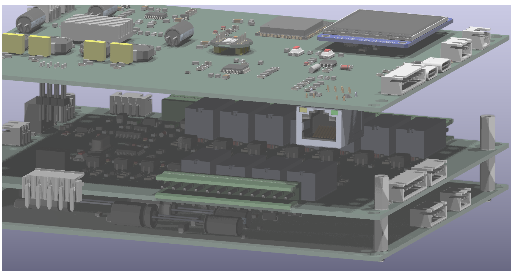
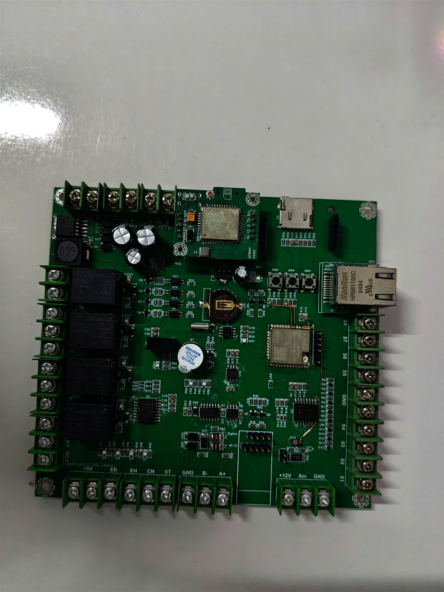
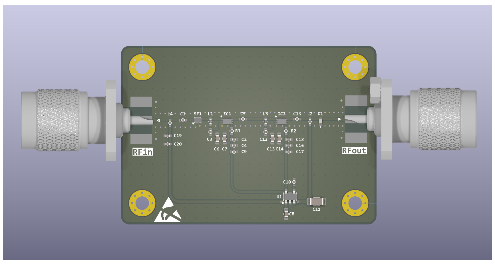

# Bùi Thanh Long — Embedded Hardware & Firmware R&D Engineer

[-thanhlong0235.github.io%2Fembedded--portfolio-10b981?style=for-the-badge)](https://thanhlong0235.github.io/embedded-portfolio/)

> **🌐 Trải nghiệm Website Portfolio đầy đủ (Song ngữ VI / EN, 6 Video chạy máy thực tế & 18 mẫu thiết kế PCB / phần cứng):**  
> 👉 **[https://thanhlong0235.github.io/embedded-portfolio/](https://thanhlong0235.github.io/embedded-portfolio/)**

---

## 🇻🇳 Giới Thiệu Tổng Quan | 🇬🇧 Executive Summary

**🇻🇳 Tiếng Việt:**  
Tôi là **Bùi Thanh Long** — **Kỹ sư R&D Phần cứng & Firmware Nhúng** với **3 năm kinh nghiệm chính thức và 1 năm thực tập/intern**, từng trực tiếp tham gia thiết kế, lập trình và hoàn thiện **hơn 150+ dự án và mẫu bo mạch điện tử thương mại – công nghiệp** đưa vào sản xuất thực tế.  
Thế mạnh cốt lõi của tôi là làm chủ **trọn vẹn vòng đời sản phẩm nhúng**: từ **phân tích bài toán & tối ưu BOM → thiết kế Schematic, Layout PCB 2–4 lớp / cao tần RF / ghép tầng 3D Multi-board → xây dựng kiến trúc Firmware Bare-metal / FreeRTOS → đo kiểm tải thực tế và xuất trọn bộ hồ sơ gia công SMT hàng loạt**.

**🇬🇧 English:**  
I am **Bùi Thanh Long**, an **Embedded Hardware & Firmware R&D Engineer** with **3 years of full-time R&D experience plus 1 year of internship**, backed by hands-on execution across **150+ commercial and industrial electronic projects and custom PCB revisions**.  
I specialize in **end-to-end embedded product ownership** — bridging power, mixed-signal, stacked multi-board, and RF hardware design (`Altium Designer`, `KiCad`, 2–4 layer EMC-hardened PCBs, SMT panelization) with deterministic microcontroller firmware (`Bare-metal`, `FreeRTOS`, high-speed `DMA`, closed-loop `PID` / motor control, industrial fieldbuses, and `4G LTE / LoRa / Ethernet` IoT gateways).

---

## ⚡ Năng Lực Kỹ Thuật Cốt Lõi | Core Engineering Pillars

| Mảng chuyên môn / Domain | Năng lực thực chiến / Practical Capabilities |
| :--- | :--- |
| **1. Firmware, RTOS & Thuật toán điều khiển** | • Kiến trúc state-machine tất định & đa nhiệm **FreeRTOS** (`ESP32 / ESP32-S3` Dual-Core SMP, `STM32 G4/F4/F1/L/G0`, `WCH RISC-V`). • Ngoại vi tốc độ cao & vòng kín: `TIM TRGO → ADC → Circular DMA` (`200 kSPS`), ngắt bảo vệ `1 µs`, điều khiển nhiệt **PID đa kênh (`RTD + SSR`)**, định lượng xung Flowmeter/Encoder. • Chế độ ngủ sâu tiết kiệm pin (`STM8L / STM32L`), lưu trữ Flash/EEPROM kèm `CRC-8/16`, cập nhật `OTA`, bootloader & xác thực `XTEA` + tool `Python`. |
| **2. Schematic, Multi-Layer / RF PCB & DFM** | • Thiết kế Schematic phân cấp (multi-sheet), Layout PCB 2–4 lớp và ghép chồng cơ khí **3D Multi-Board Stack** trên **Altium Designer** & **KiCad**. • Chống nhiễu công nghiệp (EMC) & RF: phân vùng mass công suất/analog, đường đồng mở phủ thiếc, đường truyền `50 Ω` bọc hàng rào via (`GNSS/RF LNA` + lọc SAW), cách ly quang/DC-DC/`ISO1540` & dập xung `TVS`. • Xuất hồ sơ sản xuất hàng loạt SMT: `Gerber`, `NC Drill`, tối ưu `BOM`, `Pick & Place` và ghép vỉ `Panel` (V-cut / mouse-bites). |
| **3. Điện tử công suất, Động cơ & Máy thương mại** | • Thiết kế mạch lái động cơ 3 pha **BLDC ESC** (4 lớp, cảm biến Hall & BEMF, khởi động mềm chống dòng xung, bảo vệ quá dòng & TVS hãm tái sinh). • Đóng cắt công suất: cụm **IGBT 600V/50A** phóng nạp tụ (`0–150 VDC`), góc mở **Thyristor / TRIAC / Trailing-Edge Dimmer 220VAC**, cụm **SSR 40A–100A**, sạc Solar Boost & bảo vệ BMS. • Tự động hóa thiết bị: hệ sinh thái bo mạch **máy pha cà phê 1–3 Group**, lò công nghiệp, máy điện phân, bo mở rộng `16-In / 32-Out` và điện tử ô tô `12V/24V`. |
| **4. Fieldbus, Viễn thông 4G/LoRa & HMI** | • Giao thức công nghiệp & đo lường: `RS-485 Modbus RTU` (Dual RS-485), `CAN Bus`, `SPI + DMA`, ngõ vào `4–20mA / 0–10V` (`ADS1115`), đo điện năng AC & giao tiếp `PLC 24V`. • Gateway IoT đa mạng: viễn thông di động **4G LTE / NB-IoT / GNSS** (`SIM7600`, `A7680C`, `SIM7080G`), **LoRa Mesh**, **Ethernet (`W5500`)**, `Zigbee / Sub-GHz RF`, `UHF RFID`, radar `mmWave` & `MQTT / Cloud`. • Hệ thống HMI & Audio: màn hình cảm ứng `800×480` vẽ sóng & giám sát hành trình, LED ma trận cân điện tử, ghi log `FAT32 CSV` qua USB (`CH376S`) và mạch âm thanh `OPA627` / đa kênh. |

---

## 🛠️ Hệ Sinh Thái Công Nghệ | Technical Stack

- **MCUs & Wireless SoCs (10+ Lines):** `STM32` (`G431`, `F4`, `F103`, `L`, `G030`), `ESP32` / `ESP32-S3` / `ESP8266`, `WCH RISC-V` (`CH32V003`, `CH32V203`) & `CH552`, `Nuvoton` (`MS51`, `N76E003`), `STM8S` / `STM8L`, `AVR` (`ATmega2560`, `ATmega328P`, `ATtiny`), `PIC`, `Realtek BW16`
- **Firmware & Compilers:** `C` (`C99/C11`), `C++`, `FreeRTOS`, `STM32 HAL/LL`, `ESP-IDF`, `PlatformIO`, `Keil MDK-ARM & C51`, `IAR (EWARM / EWSTM8)`, `STM32CubeIDE`, `MounRiver Studio`, `Python`, `Git`
- **Hardware EDA & Lab:** `Altium Designer`, `KiCad`, `Proteus`, `LTspice`, Digital Oscilloscope, Logic Analyzer, `ST-Link` / `J-Link`

---

## 📸 Minh Chứng Thiết Kế & Phần Cứng Thực Tế | Visual Highlights

> 🎬 **Xem trọn bộ 6 Video chạy máy thực tế & 18 hình ảnh độ phân giải cao tại [Website Portfolio](https://thanhlong0235.github.io/embedded-portfolio/#videos).**

| Từ Thiết Kế 3D Altium Đến Bo Mạch Thực Tế *(CAD-to-Hardware Bring-Up)* | Thiết Kế 4 Lớp Mạch Lái Động Cơ 3 Pha BLDC *(4-Layer BLDC ESC — CAN, Hall/BEMF, Soft-Start)* |
| :---: | :---: |
|  |  |
| **Kiến Trúc Ghép Chồng 3 Tầng 3D Multi-Board** *(3-Tier Stacked Controller — ESP32-S3, LAN, Relays)* | **Trạm Hub IoT Đa Giao Thức (4G LTE + LAN + RS-485)** *(Industrial Telemetry Hub — A7680C, W5500, Zigbee)* |
|  |  |
| **Mạch Cao Tần 2 Tầng Khuếch Đại RF / GNSS LNA** *(50-Ω Coplanar Waveguide, SAW Filter & Via Stitching)* | **Tích Hợp Tủ Điều Khiển & Đồ Thị Sóng 200 kSPS** *(Industrial Cabinet Commissioning & Waveform HMI)* |
|  |  |

---

## 🔒 Bảo Mật Thông Tin (Confidentiality & NDA Notice)

Hồ sơ này tổng hợp kỹ năng và kinh nghiệm thực chiến từ hơn 150+ dự án R&D thương mại và phát triển độc lập. Để tuân thủ cam kết bảo mật (NDA) và quyền sở hữu trí tuệ của khách hàng/doanh nghiệp, mọi tên khách hàng, mã dự án nội bộ, sơ đồ nguyên lý chi tiết (`.SchDoc`) và mã nguồn thương mại đều được lược bỏ.

---

## 📬 Liên Hệ | Contact

- **Họ tên / Name:** Bùi Thanh Long
- **Email:** [buithanhlong0235@gmail.com](mailto:buithanhlong0235@gmail.com)
- **Portfolio Web (VI / EN):** [https://thanhlong0235.github.io/embedded-portfolio/](https://thanhlong0235.github.io/embedded-portfolio/)
- **GitHub:** [@ThanhLong0235](https://github.com/ThanhLong0235)
