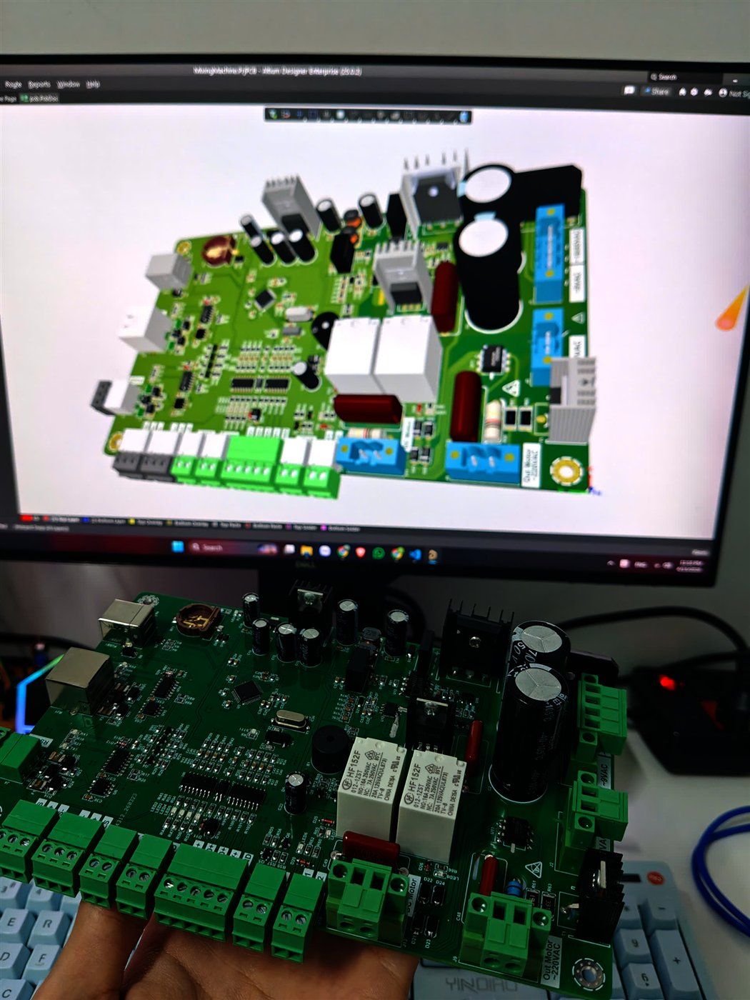
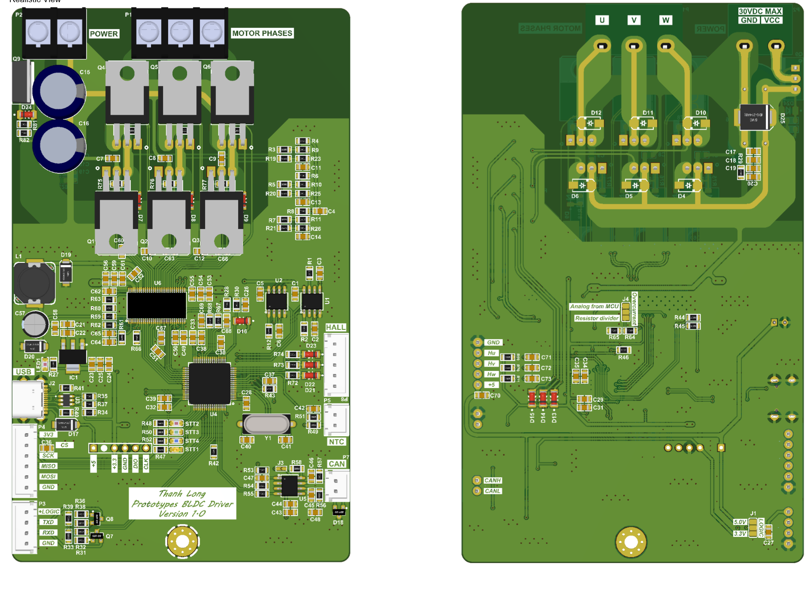
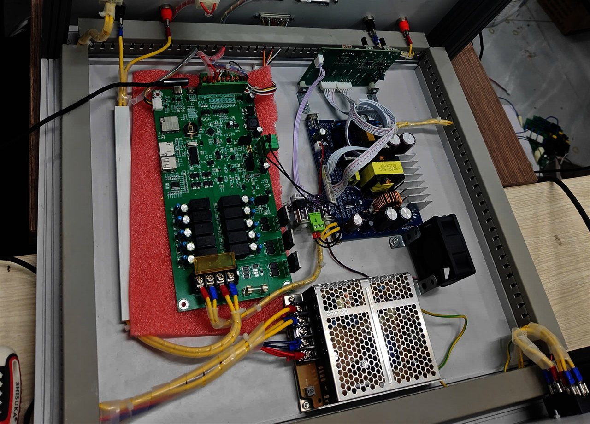

# Bùi Thanh Long — Embedded Hardware & Firmware R&D Engineer

> **Website Portfolio:** **[https://thanhlong0235.github.io/embedded-portfolio/](https://thanhlong0235.github.io/embedded-portfolio/)**

---

## Giới Thiệu | Summary

- **Tiếng Việt:** Kỹ sư R&D Phần cứng & Firmware Nhúng (**3 năm chính thức + 1 năm thực tập**), trực tiếp phát triển **50+ dự án & mẫu bo mạch thương mại – công nghiệp**. Làm chủ trọn quy trình từ thiết kế Schematic, Layout PCB 2–4 lớp đến lập trình Firmware **Bare-metal / FreeRTOS**, đo kiểm tải và bàn giao hồ sơ SMT hàng loạt.
- **English:** Full-cycle Embedded Hardware & Firmware R&D Engineer (**3 yrs full-time + 1 yr internship**) with hands-on delivery across **50+ commercial & industrial projects** — owning schematic capture, 2–4 layer EMC-hardened PCB layout, deterministic **Bare-metal / FreeRTOS** firmware, bench validation, and mass-production SMT release.

---

## Năng Lực Cốt Lõi | Core Capabilities

| Chuyên môn / Domain | Kỹ năng thực chiến / Key Capabilities |
| :--- | :--- |
| **Firmware & RTOS** | `Bare-metal` & `FreeRTOS` (`STM32`, `ESP32-S3`, `RISC-V`) • `ADC + DMA` (`200 kSPS`), vòng kín `PID (RTD + SSR)`, Encoder/Flowmeter • `Deep-Sleep`, Flash/EEPROM `CRC`, `OTA` & Bootloader. |
| **Hardware & PCB DFM** | Schematic phân cấp & Layout PCB 2–4 lớp (`Altium Designer`, `KiCad`) • Chống nhiễu EMC, phân vùng mass, cách ly quang/`ISO1540`/DC-DC, `TVS` • Hồ sơ SMT (`BOM`, `Gerber`, `Pick & Place`, `Panel`). |
| **Power & Machines** | Mạch lái động cơ 3 pha `BLDC ESC` (Hall/BEMF, soft-start) • Đóng cắt `IGBT 600V`, `Thyristor / TRIAC`, cụm `SSR`, BMS • Máy pha cà phê 1–3 Group, thiết bị công nghiệp & ô tô `12V/24V`. |
| **Fieldbus, IoT & HMI** | `RS-485 Modbus RTU`, `CAN Bus`, `SPI-DMA`, analog `4–20mA / 0–10V`, `PLC 24V` • Gateway `4G LTE / GNSS`, `LoRa`, `Ethernet (W5500)`, `UHF RFID`, `MQTT` • Màn hình cảm ứng `HMI` & log `USB CSV`. |

---

## Công Nghệ | Tech Stack

- **MCUs & SoCs:** `STM32` (`G4`, `F4`, `F1`, `L`, `G0`), `ESP32` / `ESP32-S3` / `ESP8266`, `WCH RISC-V` (`CH32V003`, `V203`), `Nuvoton`, `STM8S/L`, `AVR`, `PIC`, `BW16`
- **Firmware & Tools:** `C` (`C99/C11`), `C++`, `FreeRTOS`, `STM32 HAL/LL`, `ESP-IDF`, `PlatformIO`, `Keil`, `IAR`, `STM32CubeIDE`, `Python`, `Git`
- **Hardware & Lab:** `Altium Designer`, `KiCad`, `Proteus`, `LTspice`, Oscilloscope, Logic Analyzer, `ST-Link` / `J-Link`

---

## Hình Ảnh Tiêu Biểu | Visual Highlights

> Xem đầy đủ **6 Video vận hành thực tế** & **12 mẫu phần cứng** tại **[thanhlong0235.github.io/embedded-portfolio](https://thanhlong0235.github.io/embedded-portfolio/#videos)**.

| Từ Thiết Kế 3D Altium Đến Mạch Thật *(CAD-to-Hardware Bring-Up)* | Mạch Lái Động Cơ 3 Pha BLDC 4 Lớp *(4-Layer BLDC ESC — CAN, Hall/BEMF)* |
| :---: | :---: |
|  |  |
| **Trạm Hub IoT Công Nghiệp (4G + LAN + RS-485)** *(Multi-Protocol Industrial Telemetry Hub)* | **Tích Hợp Tủ Điều Khiển Máy Công Nghiệp** *(Industrial Cabinet Commissioning)* |
|  |  |

---

## Liên Hệ | Contact

- **Email:** [buithanhlong0235@gmail.com](mailto:buithanhlong0235@gmail.com) · **Web:** [thanhlong0235.github.io/embedded-portfolio](https://thanhlong0235.github.io/embedded-portfolio/) · **GitHub:** [@ThanhLong0235](https://github.com/ThanhLong0235)
