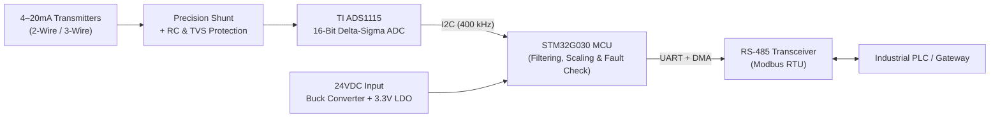

# Project 01: Industrial Sensor & 4–20mA Acquisition Node

> **Summary:** `[TODO: High-precision 4–20mA / analog sensor acquisition node with isolated RS-485 Modbus RTU telemetry for industrial monitoring.]`

---

## 1. Project Overview

- **Role:** Embedded Hardware & Firmware Engineer
- **Application Domain:** Industrial Automation / Process Monitoring
- **Problem Statement:** `[TODO: Industrial PLC/SCADA systems needed a compact, low-cost, noise-immune node to digitize multiple 4–20mA analog transmitters over long cable runs.]`
- **Solution Summary:** `[TODO: Designed a custom STM32G030 + ADS1115 acquisition board with precision current-sense front-end, hardware filtering, and deterministic Modbus RTU slave firmware.]`

---

## 2. System Block Diagram

---

## 3. Board & Hardware Specifications

| Component / Block | Details |
| :--- | :--- |
| **Target Board** | `[TODO: Custom 2-Layer PCB / Prototype Carrier Board]` |
| **Microcontroller** | `STM32G030` (ARM Cortex-M0+ @ 64 MHz, Flash/SRAM specs) |
| **External ADC** | `ADS1115` 16-bit I2C ADC with internal PGA & voltage reference |
| **Analog Input Range** | `4–20 mA` (with `< 3.5 mA` open-loop / `> 21 mA` over-current fault detection) |
| **Power Supply** | `12–24 VDC` industrial rail with reverse-polarity, fuse, and TVS protection |
| **Fieldbus Interface** | `RS-485` half-duplex (`9600–115200 bps`), configurable slave ID |
| **PCB Design Tool** | `Altium Designer` (`./hardware/` for schematic PDF & 3D PCB views) |

---

## 4. Firmware & Software Architecture

| Item | Specification |
| :--- | :--- |
| **Language** | `C` (C11) |
| **IDE & Compiler** | `STM32CubeIDE` (`arm-none-eabi-gcc`) |
| **SDK / Drivers** | `STM32 HAL / LL`, custom non-blocking `ADS1115` driver, Modbus RTU engine |
| **Filtering & Calibration** | Two-point gain/offset stored in internal Flash + moving-average digital filter |
| **Safety & Reliability** | Independent Watchdog (`IWDG`), I2C bus lockup recovery, CRC-16 frame check |
| **PC Validation Tooling** | `Modbus Poll` / Python `pymodbus` test script |

---

## 5. Key Engineering Challenges & Results

- **Analog Noise Rejection:** `[TODO: Describe shunt resistor tolerance, RC cutoff frequency, and PGA gain selection to maximize effective resolution.]`
- **Fault Resilience:** `[TODO: Describe handling of sensor wire break (< 3.8 mA), I2C bus hang recovery, and RS-485 transient immunity.]`

| Metric | Measured Performance |
| :--- | :--- |
| **Current Loop Accuracy** | `[TODO: e.g., ±0.05% Full Scale after 2-point calibration]` |
| **Effective Resolution** | `[TODO: e.g., 0.001 mA step]` |
| **Modbus Turnaround Time** | `[TODO: e.g., < 2 ms @ 115200 bps]` |

---

## 6. Folder Contents

- [`./hardware/`](./hardware/) — Schematic PDF, BOM excerpt, PCB 2D/3D renders
- [`./firmware/`](./firmware/) — Public driver source/headers (`ads1115.c/.h`, register map)
- [`./media/`](./media/) — Hardware photos, oscilloscope & logic analyzer captures

[← Back to Main Portfolio](../../README.md)
