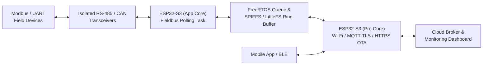

# Project 02: Wireless Industrial IoT Edge Gateway

> **Summary:** `[TODO: Dual-core ESP32-S3 industrial edge gateway polling fieldbus devices and streaming telemetry to cloud MQTT brokers with offline buffering and OTA updates.]`

---

## 1. Project Overview

- **Role:** Embedded Firmware & Hardware Designer
- **Application Domain:** Industrial IoT (IIoT) / Remote Telemetry
- **Problem Statement:** `[TODO: Legacy RS-485/UART industrial equipment lacked cloud connectivity, local buffering during Wi-Fi dropouts, and remote firmware maintainability.]`
- **Solution Summary:** `[TODO: Built an ESP32-S3 based edge gateway running FreeRTOS on ESP-IDF with custom Altium component libraries & carrier PCB, TLS-secured MQTT telemetry, and BLE local provisioning.]`

---

## 2. System Block Diagram

---

## 3. Board & Hardware Specifications

| Component / Block | Details |
| :--- | :--- |
| **Target Board** | `[TODO: Custom Carrier PCB with Goouuu / Espressif ESP32-S3 Module]` |
| **Main SoC** | `ESP32-S3` (Dual-core XTensa LX7 @ 240 MHz, 8/16 MB Flash, PSRAM) |
| **Connectivity** | `2.4 GHz Wi-Fi (802.11 b/g/n)`, `Bluetooth 5 (LE)`, external IPEX antenna option |
| **Field Interfaces** | `RS-485`, `UART`, `I2C` (RTC + Environmental Sensor), `USB-C` native JTAG/CDC |
| **Power Architecture** | `12–24 VDC` buck converter to `5V` & high-current `3.3V` rail (`>= 1A` peak RF burst) |
| **PCB & Footprint Design** | `Altium Designer` (including custom verified schematic symbols & PCB footprints) |

---

## 4. Firmware & Software Architecture

| Item | Specification |
| :--- | :--- |
| **Language** | `C / C++` |
| **Framework & RTOS** | `ESP-IDF v5.x` + SMP `FreeRTOS` |
| **IDE & Build System** | `VS Code` + ESP-IDF Extension, `CMake`, `Ninja` |
| **Networking & Security** | `MQTT over TLS`, `SNTP` time sync, `HTTPS OTA` with rollback protection |
| **Storage** | `NVS` (device config & credentials), `LittleFS` (offline telemetry queue) |
| **Provisioning** | `BLE GATT` / captive portal for field Wi-Fi & broker setup |

### FreeRTOS Task Partitioning
- **`modbus_master_task` (Core 1, High Priority):** Deterministic polling of downstream slave registers with configurable timeouts.
- **`storage_manager_task` (Core 1, Medium Priority):** Caches timestamped JSON/binary payloads to Flash if cloud link drops.
- **`mqtt_telemetry_task` (Core 0, Medium Priority):** Publishes live and buffered telemetry, handles remote RPC commands.
- **`ota_watchdog_task` (Core 0, Low Priority):** Validates firmware image health and manages safe rollback.

---

## 5. Key Engineering Challenges & Results

- **RF Power Rail Stability:** `[TODO: Describe decoupling & buck layout to prevent brownout resets during Wi-Fi TX bursts.]`
- **Zero Data Loss on Disconnects:** `[TODO: Describe Flash wear-leveling ring buffer behavior during multi-hour internet outages.]`

| Metric | Measured Performance |
| :--- | :--- |
| **Polling Capacity** | `[TODO: e.g., Up to 32 Modbus slave nodes @ 1s cycle]` |
| **Offline Buffer Capacity** | `[TODO: e.g., 10,000+ timestamped records in Flash]` |
| **OTA Update Time** | `[TODO: e.g., ~25 seconds over Wi-Fi with automatic rollback]` |

---

## 6. Folder Contents

- [`./hardware/`](./hardware/) — Carrier schematic PDF, custom Altium library notes, 3D PCB view
- [`./firmware/`](./firmware/) — Architecture snippets, task configuration, payload schema
- [`./media/`](./media/) — Board photos, serial logs, dashboard screenshots

[← Back to Main Portfolio](../../README.md)
