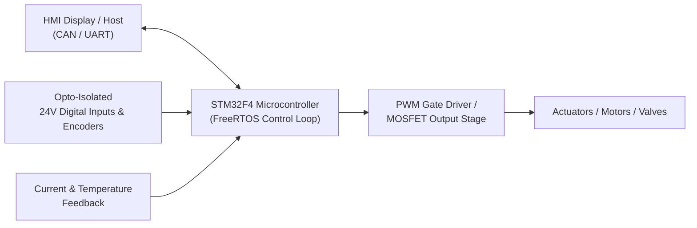

# Project 03: Custom Embedded Controller & Power/IO Board

> **Summary:** `[TODO: Real-time STM32 control board featuring galvanic I/O isolation, actuator/motor drive stages, and deterministic hardware fault protection.]`

---

## 1. Project Overview

- **Role:** Embedded Hardware & Firmware Engineer
- **Application Domain:** Machine Control / Embedded Automation
- **Problem Statement:** `[TODO: Describe the target machine, actuator, or control subsystem and its timing, safety, and EMI requirements.]`
- **Solution Summary:** `[TODO: Developed a custom multi-layer PCB and real-time STM32 firmware integrating isolated digital I/O, PWM drive, current feedback, and CAN/UART HMI interface.]`

---

## 2. System Block Diagram

---

## 3. Board & Hardware Specifications

| Component / Block | Details |
| :--- | :--- |
| **Target Board** | `[TODO: Custom 4-Layer FR4 PCB (Signal / GND / Power / Signal)]` |
| **Microcontroller** | `[TODO: e.g., STM32F407VET6 (ARM Cortex-M4F @ 168 MHz, FPU, DSP)]` |
| **Digital Inputs** | `[TODO: e.g., 8× Opto-isolated 24V PNP/NPN inputs + hardware debounce]` |
| **Power / Drive Outputs** | `[TODO: e.g., 4× High-side/Low-side MOSFET PWM channels + flyback protection]` |
| **Communication** | `CAN 2.0B`, `RS-485 / UART` (HMI), `SWD` debug port |
| **EDA & Layout** | `Altium Designer` — impedance/current-width sizing, creepage & clearance |

---

## 4. Firmware & Software Architecture

| Item | Specification |
| :--- | :--- |
| **Language** | `C` |
| **IDE & Toolchain** | `Keil MDK-ARM` / `STM32CubeIDE` |
| **RTOS / Timing** | `FreeRTOS` + Hardware Timer ISRs for deterministic PID / PWM control |
| **Peripherals Used** | Advanced Timers (`TIM1/TIM8` complementary PWM), `ADC + DMA`, `bxCAN`, `UART + DMA`, `IWDG` |
| **Diagnostics** | Fault state machine, non-volatile error log, over-current hardware break input |

---

## 5. Key Engineering Challenges & Results

- **EMI & Switching Transients:** `[TODO: Describe snubber/flyback diode selection, optocoupler isolation barrier, and PCB return-path layout.]`
- **Real-Time Determinism:** `[TODO: Describe separating hard real-time timer interrupts (PID/protection) from lower-priority RTOS communication tasks.]`

| Metric | Measured Performance |
| :--- | :--- |
| **Control Loop Frequency** | `[TODO: e.g., 10 kHz deterministic ISR]` |
| **Over-current Trip Latency** | `[TODO: e.g., < 5 µs via Timer Break Input]` |
| **Continuous Thermal Rise** | `[TODO: e.g., ΔT < 18 °C at full rated load]` |

---

## 6. Folder Contents

- [`./hardware/`](./hardware/) — Schematic blocks, stack-up notes, PCB 3D top/bottom renders
- [`./firmware/`](./firmware/) — Control loop module, state machine diagram, CAN/HMI protocol spec
- [`./media/`](./media/) — Assembled PCB photos, PWM/current oscilloscope waveforms, demo video link

[← Back to Main Portfolio](../../README.md)
