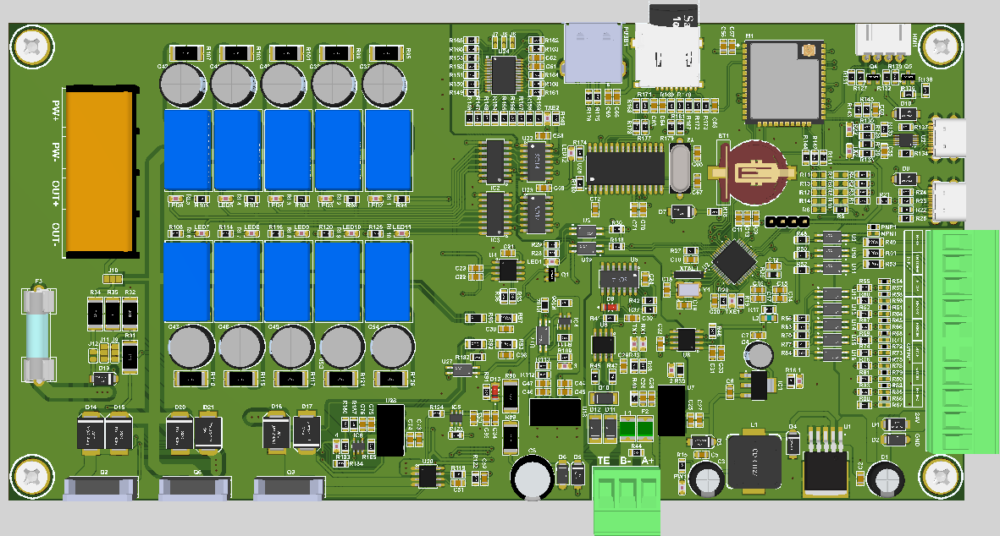
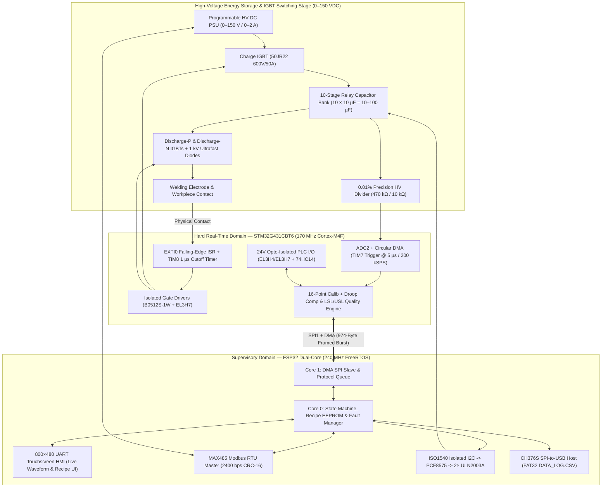
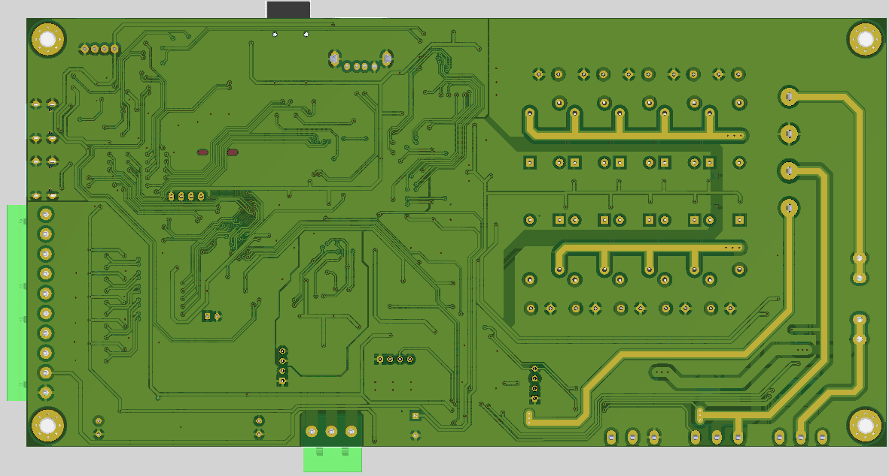
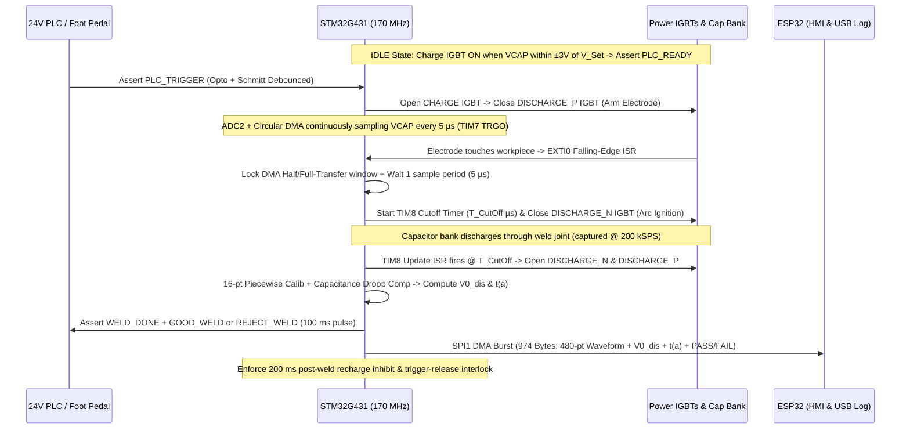
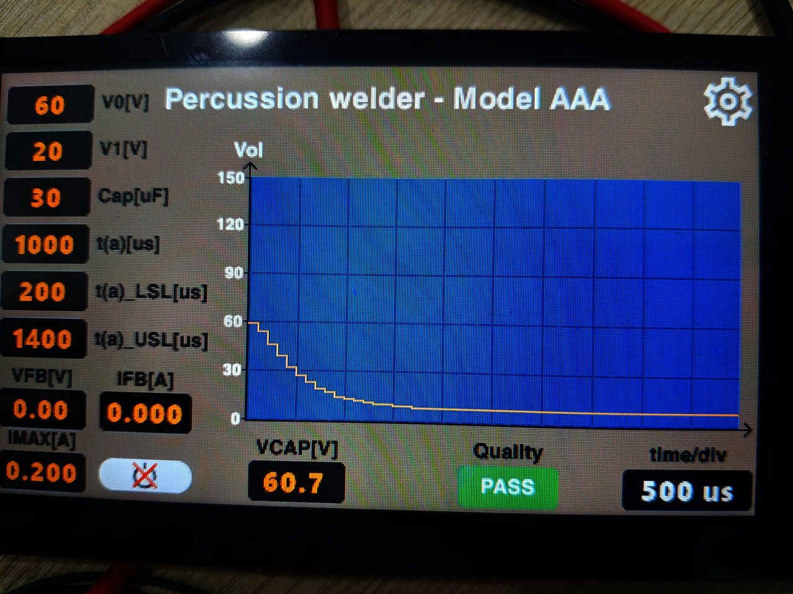
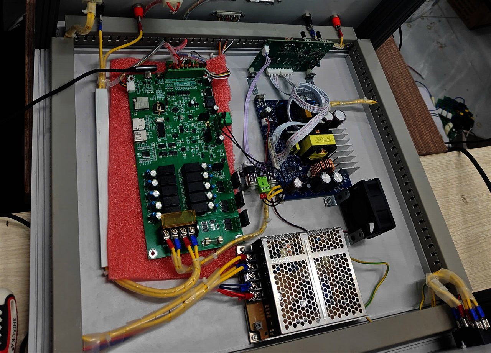

# Project 03: Dual-MCU Capacitor-Discharge Percussion Welding Controller (Rev V3)

> **Summary:** Industrial embedded controller for microsecond-scale capacitor-discharge percussion welding, combining a **170 MHz STM32G431** hard real-time acquisition/ignition engine (`200 kSPS` DMA waveform capture, `1 µs` IGBT cutoff) with a **dual-core ESP32** FreeRTOS supervisory processor for programmable HV power control, `10–100 µF` relay bank switching, touchscreen oscilloscope HMI, and USB production traceability.

-2ea44f?style=flat-square)
-03234B?style=flat-square&logo=stmicroelectronics)
-E7352C?style=flat-square&logo=espressif)

---

## 1. Project Overview

- **Role:** Lead Embedded Hardware & Firmware R&D Engineer (Full-cycle: Schematic, PCB Layout, Dual-MCU Firmware, HMI UI, Cabinet Commissioning)
- **Timeline / Context:** Commercial Industrial R&D — Multi-generation evolution (`Rev V1 → V2 → V3`, Production Release)
- **Problem Statement:** Capacitor-discharge percussion welding joins fine wires and dissimilar metal components using a high-voltage (`0–150 VDC`), short-duration (`100–5,000 µs`) arc pulse. Automated production lines require:
  1. **Microsecond-accurate ignition & arc cutoff** synchronized to physical workpiece contact without CPU jitter.
  2. **In-situ weld quality verification (`PASS` / `REJECT`)** on every single weld by capturing the transient capacitor discharge curve and verifying both ignition peak voltage (`V0`) and effective arc duration (`t(a)`) against Upper/Lower Specification Limits (`USL` / `LSL`).
  3. **High EMI/transient immunity** against `600 V / 50 A` IGBT switching spikes while maintaining responsive HMI waveform rendering, Modbus RTU power supply regulation, PLC handshaking, and non-blocking USB CSV data logging.
- **Solution Summary:** Engineered the **Rev V3 Heterogeneous Dual-MCU Controller PCB (`220 mm × 110 mm`)** that cleanly decouples hard real-time power electronics and `200 kSPS` DMA waveform digitization (`STM32G431CBT6`) from multi-tasking HMI, fieldbus, capacitor-bank, and file-system operations (`ESP32-WROOM-32U`), linked via a framed `SPI + DMA` inter-processor bus.

---

## 2. System Architecture

---

## 3. Hardware & Board Specifications

| Subsystem | V3 Hardware Specification |
| :--- | :--- |
| **Form Factor & Manufacturing** | Custom `220.0 mm × 110.0 mm` 2-layer FR4 PCB (`209 mm × 99 mm` M4 mounting grid), panelized `2×4` for SMT assembly |
| **Real-Time Control MCU** | `STM32G431CBT6` — ARM Cortex-M4F w/ DSP & FPU @ `170 MHz`, `128 KB` Flash, `32 KB` SRAM, `45°` rotated LQFP-48 placement |
| **Supervisory / UI SoC** | `ESP32-WROOM-32U` — Dual-core 32-bit XTensa LX6 @ `240 MHz`, U.FL external antenna option |
| **HV Switching Stage** | `3× 50JR22` (`600 V / 50 A`, TO-247) N-Channel IGBTs (`CHARGE`, `DISCHARGE_P`, `DISCHARGE_N`) + `US5MC` (`1 kV / 5 A`) ultrafast rectifiers + `10 A` fuse |
| **Isolated Gate Drive** | `2× Mornsun B0512S-1W2R` isolated `5V → 12V` DC-DC converters + `EL3H7` optocouplers per high-voltage switch |
| **Programmable Capacitor Bank** | `10× JZC-32F` (`10 A`) SPDT relays switching `10× 10 µF` axial energy-storage capacitors (`10 µF` to `100 µF` in `10 µF` steps) |
| **Relay Expansion & Isolation** | `TI ISO1540` bidirectional I2C isolator + `B0505S-1W2R` isolated `5V` rail → `PCF8575TS` 16-bit I/O expander → `2× ULN2003ADR` Darlington arrays |
| **HV Analog Front-End** | `0.01%` ultra-precision `470 kΩ / 10 kΩ` resistor divider (`0–150 VDC` capacitor voltage feedback) + `ACS712T-05B` Hall current sensor |
| **Industrial 24V PLC Interface** | **3× Inputs:** `RESET`, `TRIGGER`, `EMERGENCY_STOP` (`EL3H4` AC/DC optocouplers + `74HC14` hex Schmitt-trigger hardware debounce) **5× Outputs:** `READY`, `ERROR`, `WELD_DONE`, `GOOD_WELD`, `REJECT_WELD` (`EL3H7` opto-isolated outputs) |
| **External Interfaces** | `RS-485` (`MAX485ESA` w/ fuse protection), `UART` HMI port (`XH2.54-4P`), `USB-A` Host (`CH376S`), `MicroSD` slot, `2× USB Type-C` (`CH340X` debug/programming) |
| **Board Power Tree** | `24 VDC` cabinet input → `LM2596HVS-5.0` (`5V / 3A` buck) → `AMS1117-3.3` logic rail + `CR1220` backup cell + `3×` isolated `1W` DC-DC rails |
| **EDA Toolchain** | `Altium Designer` — Hierarchical multi-sheet schematics (`Power`, `Loads`, `IO_PLC`, `RS485`, `STM32`, `ESP32`, `SD_USB`), DRC, 2×4 panelization |

### Key Hardware Design Evolution (`Rev V1 → V2 → V3`)
- **Zoned Ground Topology & Exposed High-Current Busbars:** Partitioned high-current capacitor discharge return paths from sensitive analog/MCU ground zones. Added solder-mask window openings along the bottom-layer relay/capacitor discharge tracks (visible below) to reinforce copper cross-section with solder for high pulse `dI/dt` handling and heat dissipation.
- **Eliminating Slow External I2C ADC Latency:** Earlier revisions relied on an external `ADS1015/ADS1115` I2C ADC and current-buffer stage, whose kSPS ceiling could not resolve steep microsecond discharge edges. Rev V3 routes a `0.01%` precision `470 kΩ / 10 kΩ` divider directly into the `STM32G431` high-speed 12-bit SAR ADC (`2.5-cycle` sample window) driven by hardware timer `TRGO` + DMA.
- **Hardware Debounce & Transient Hardening:** Cascaded `EL3H4`/`EL3H7` optical isolation with `3× 74HC14` hex inverting Schmitt triggers so contact bounce and arc radiation cannot falsely trigger weld cycles or emergency stops.

> Detailed PCB subsystem breakdown, power tree, and PLC I/O mapping are documented in [`./hardware/README.md`](./hardware/README.md).

---

## 4. Firmware & Software Architecture

| Layer | STM32 Real-Time Engine | ESP32 Supervisory Engine |
| :--- | :--- | :--- |
| **Language** | `C` (C99/C11) | `C++` (`Arduino / ESP-IDF` hybrid) |
| **IDE & Toolchain** | `Keil MDK-ARM µVision 5` (`ARMCC V5.06`) + `STM32CubeMX` | `VS Code` + `PlatformIO` (`xtensa-esp32-elf-g++`) |
| **Execution Model** | Deterministic bare-metal state machine + zero-latency Timer/EXTI/DMA ISRs | Symmetric Multi-Processing (`FreeRTOS` pinned across Core 0 & Core 1) |
| **Key Peripherals** | `ADC2 + Circular DMA`, `TIM7` (`5 µs` `TRGO`), `TIM8` (`1 µs` cutoff ISR), `EXTI0`, `SPI1 Master + DMA` | `HSPI Slave + DMA` (`ESP32DMASPI`), `2× UART` (HMI & Modbus RS-485), `I2C`, `VSPI` (`CH376S`), `EEPROM` |

### Microsecond Percussion Weld Cycle (`STM32G431`)

### Dual-Core Task Partitioning (`ESP32` FreeRTOS)
- **Core 1 — Dedicated Inter-MCU DMA Link:**
  - `SPISlaveTask` & `SPIDataTask`: Allocates `1024-byte` DMA-capable buffers (`SPI_MODE0`) and queues incoming `STM32` packets via FreeRTOS `xQueue` so high-speed `974-byte` waveform bursts are ingested without stalling UI or storage tasks.
- **Core 0 — Supervisory Control, Fieldbus, UI & Storage:**
  - `HMI_Task` *(Priority 3, `115200 bps` UART)*: Drives the `800×480` touchscreen across 7 pages (`Logo`, `Boot Diagnostics`, `Home Oscilloscope`, `Settings 1 & 2`, `Fault Counter Log`, `Emergency Stop`), dynamically rescaling 480-point discharge waveforms via linear interpolation across `100–500 µs/div`.
  - `PROGRAM_Task` *(Priority 2, `2 ms` tick)*: Coordinates `IDLE / DISCHARGE / EMERGENCY` states, manages the `10–100 µF` relay sequence, persists 11 recipe parameters to non-volatile memory, and aggregates subsystem faults (`SPI`, `USB Disk`, `Trigger Timeout`, `HV Power`).
  - `POWER_Task` *(Priority 1, `2400 bps` RS-485)*: Custom non-blocking **Modbus RTU Master** (`0x03` Read Holding Registers, `0x10` Write Multiple Registers, hardware-verified `CRC-16`) maintaining closed-loop voltage (`V_Set + V_Calib`), current limit (`I_MAX`), and output state synchronization with the external HV DC supply.
  - `I2C_Task` & `USB_Task` *(Priority 0)*: Updates the isolated `PCF8575` relay bank (`5 ms` scan with read-back verification) and appends sequence-numbered 480-sample CSV records (`DATA_LOG.CSV`) to FAT12/16/32 USB flash drives in `255-byte` chunks via `CH376S`.

> Full inter-MCU SPI frame specification, calibration math, and Modbus synchronization flow are detailed in [`./firmware/README.md`](./firmware/README.md).

---

## 5. Key Engineering Challenges & Solutions

1. **Challenge — Resolving Steep Microsecond Discharge Curves & Small-Capacitance Droop:**
   - **Root Cause:** At low capacitance settings (`10–40 µF`), capacitor discharge time constants shrink to a few hundred microseconds, causing both sampling-phase misalignment at arc ignition and RC divider droop distortion near the tail of the waveform.
   - **Solution:** Configured `ADC2` in hardware-triggered DMA circular mode (`5 µs` period via `TIM7 TRGO`). Used the `EXTI0` workpiece-contact interrupt to phase-lock the DMA Half-Transfer (`HT`) and Transfer-Complete (`TC`) copy windows before firing `DISCHARGE_N`. Implemented a 16-point piecewise-linear lookup table (`0–150 V`) combined with a non-linear capacitance-dependent error compensation model (`< 50 µF` scaling factor) to achieve accurate `V0_dis` and `t(a)` extraction across the full `10–100 µF` range.

2. **Challenge — Preventing False Triggers & Latch-Up Under `600 V / 50 A` IGBT Switching Noise:**
   - **Root Cause:** Rapid `dI/dt` discharge transients coupled into high-impedance trigger lines and caused occasional power-up state race conditions between the charging and discharging IGBTs.
   - **Solution:** Implemented strict break-before-make IGBT sequencing (`DISCHARGE_P/N` forced reset at startup and prior to any `CHARGE` enable, plus a mandatory `200 ms` post-discharge settling delay and trigger-release check). Combined isolated `B0512S-1W2R` gate supplies, `ISO1540` I2C isolation, and `74HC14` Schmitt triggers with asymmetric software debounce (`20` vs `1000` cycles on `EMERGENCY_STOP`).

3. **Challenge — Zero-Drop Factory Traceability Without Blocking Weld Readiness:**
   - **Root Cause:** Writing ~2.5 KB CSV lines (480 timestamped voltage points at `5 µs` increments) to a USB flash drive over `CH376S` takes tens of milliseconds and exceeds the chip's internal `255-byte` FIFO limit.
   - **Solution:** Offloaded file management entirely to Core 0 on the `ESP32` using a chunked `255-byte` writer (`writeLongBuffer`) with tail-cursor sequence-number recovery (`last 3 KB` scan on existing `DATA_LOG.CSV`), allowing the `STM32G431` to re-arm for the next weld cycle immediately after the `200 ms` capacitor recharge window.

---

## 6. Verified Specifications & Measured Results

| Parameter / Metric | Specification / Measured Performance |
| :--- | :--- |
| **Programmable Charge Voltage (`V0`)** | `0 – 150 VDC` (`0.1 V` telemetry resolution, `±3 V` ready window) |
| **Programmable Capacitance (`Cap`)** | `10 – 100 µF` (`10 µF` steps via 10-stage relay bank) |
| **Waveform Sampling Rate** | `200 kSPS` (`5 µs` deterministic `TIM7 → ADC2 → DMA` interval) |
| **Arc Cutoff Timer Resolution (`T_CutOff`)** | `1 µs` hardware timer resolution (`100 – 5,000 µs` configurable range) |
| **HMI Waveform Display & Scaling** | `480 points` per weld on `800×480` TFT (`100 / 200 / 300 / 400 / 500 µs/div`) |
| **PLC Handshake Timing** | `100 ms` deterministic output pulses (`DONE`, `GOOD`, `REJECT`) + continuous `READY`/`ERROR` |
| **STM32G431 Memory Footprint** | `19.08 KB` Flash (`18,116 B` Code + `972 B` RO, `< 15%` of 128 KB) / `10.89 KB` RAM (`34%` of 32 KB) |

### Hardware & Live Waveform Gallery

| Live Discharge Waveform & `PASS` Judgment on 800×480 HMI | Industrial Enclosure Integration (V3 PCB + HV PSU + 24V PSU) |
| :---: | :---: |
|  |  |

---

## 7. Repository Contents & Confidentiality Notice

- [`./hardware/README.md`](./hardware/README.md) — Detailed V3 hardware block breakdown, power tree, isolation boundaries, and industrial connector pinout.
- [`./firmware/README.md`](./firmware/README.md) — Dual-MCU firmware architecture, inter-processor SPI-DMA frame specification, quality judgment algorithm, and Modbus/USB data flows.
- [`./media/`](./media/) — Sanitized 3D PCB top/bottom renders, live discharge waveform capture, and industrial cabinet assembly photo.

> **Confidentiality & IP Notice:** This system was developed as a commercial industrial R&D product. To respect client NDA and intellectual property, proprietary C/C++ source code, Altium schematic/PCB source files, and manufacturing Gerbers are intentionally excluded from this repository. All architectural diagrams, design trade-offs, and performance metrics are presented for engineering portfolio evaluation.

[← Back to Main Portfolio](../../README.md)
