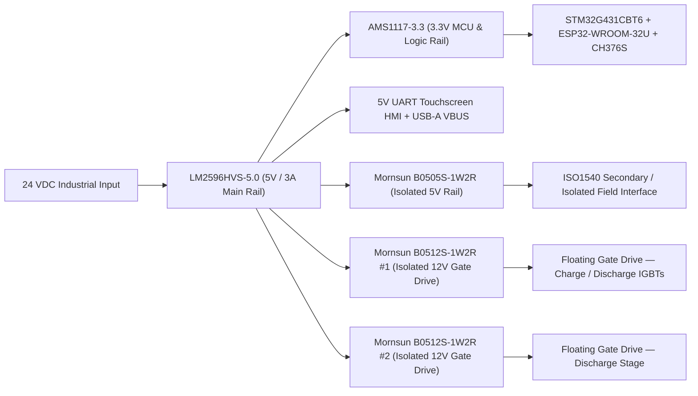

# Hardware Design & Subsystem Architecture — Percussion Welder Controller (Rev V3)

> Architectural documentation of the `220 mm × 110 mm` Rev V3 mixed-signal & high-voltage controller PCB designed in Altium Designer. *(Full schematic `.SchDoc` and manufacturing Gerber files are omitted under commercial IP policy.)*

---

## 1. Multi-Sheet Schematic Organization

The V3 Altium Designer project (`welding_control_V3.PrjPCB`) is structured into eight hierarchical schematic sheets to enforce clear isolation boundaries and layout rules:

| Sheet | Functional Scope | Key Components |
| :--- | :--- | :--- |
| **`main.SchDoc`** | Top-level sheet interconnecting power, control, isolation, and high-voltage blocks | Inter-sheet ports & net classes |
| **`Power.SchDoc`** | Primary `24 VDC` buck regulation, `3.3 V` logic rail, and three isolated DC-DC domains | `LM2596HVS-5.0`, `AMS1117-3.3`, `B0505S-1W2R`, `2× B0512S-1W2R` |
| **`Loads.SchDoc`** | High-voltage charge/discharge IGBT switches, ultrafast rectifiers, `10×` relay capacitor bank, HV sensing | `3× 50JR22` IGBTs, `US5MC` diodes, `10× JZC-32F` relays, `10× 10 µF` caps, `470 kΩ / 10 kΩ` (`0.01%`), `ACS712T-05B` |
| **`STM32.SchDoc`** | Hard real-time MCU core, clock tree, high-speed `VCAP` ADC input, `TOUCH` contact sense, SPI1 master | `STM32G431CBT6`, `8 MHz` & `32.768 kHz` crystals, `EL3H7` optos, `74HC14` |
| **`ESP32.SchDoc`** | Supervisory dual-core SoC, isolated I2C relay driver bus, HMI header, USB-C UART bridge | `ESP32-WROOM-32U`, `ISO1540`, `PCF8575TS`, `2× ULN2003ADR`, `CH340X` |
| **`IO_PLC.SchDoc`** | Galvanically isolated `24 V` industrial PLC digital inputs (PNP/NPN selectable) and outputs | `3× EL3H4` (AC/DC input optos), `5× EL3H7` (output optos), `74HC14`, `KF-5.08-10P` |
| **`RS485.SchDoc`** | Slew-rate-limited RS-485 transceiver with resettable polyfuse protection for HV PSU control | `MAX485ESA`, `2× MF-MSMF010-2` PTC fuses, status LEDs (`TXE`, `TX`, `RX`) |
| **`SD_USB.SchDoc`** | USB-A flash drive host controller, MicroSD card socket, and backup RTC battery holder | `CH376S` (`12 MHz` crystal), `USB-A` receptacle, `MicroSD` push-push slot, `CR1220` |

---

## 2. Power Tree & Galvanic Isolation Architecture

### Isolation & EMC Design Highlights
1. **Floating High-Voltage IGBT Gate Drives:** High-side/low-side `50JR22` (`600 V`, `50 A`) IGBTs cannot be driven directly from logic ground without risking ground-bounce latch-up during peak discharge currents. Dedicated `1 W` isolated `5V → 12V` converters (`B0512S-1W2R`) paired with `EL3H7` optocouplers provide clean `12 V` gate drive with galvanic isolation.
2. **Isolated Relay Expansion (`ISO1540`):** Coil kickback and capacitive coupling across the 10-relay capacitor bank (`RL1–RL10`) are isolated from the ESP32 I2C bus using a bidirectional `ISO1540` isolator, `PCF8575TS` 16-bit expander, and dual `ULN2003ADR` Darlington sink drivers with integrated freewheeling clamp diodes.
3. **High-Current Copper Reinforcement:** Bottom-layer copper tracks connecting `J4` (`HV Power IN / Weld OUT`), `10 A` fuse `F3`, relays `RL1–RL10`, axial capacitors `C37–C54`, and TO-247 IGBTs `Q2/Q3/Q6` feature exposed solder-mask windows to allow heavy solder tinning, lowering series resistance ($R_{\text{ESR}}$) and thermal rise during repetitive pulse welding.

---

## 3. Industrial Interfaces & Connector Summary

| Connector | Type | Signal Function |
| :--- | :--- | :--- |
| **`J4`** | `HB9500-4P` High-Current Barrier Terminal | `PW+ / PW-` (0–150 VDC from programmable HV supply) & `OUT+ / OUT-` (to welding electrode & fixture) |
| **`J3`** | `KF-5.08-10P` Pluggable Phoenix Terminal | `24 VDC / GND` board supply + `3×` Opto-isolated PLC Inputs (`RESET`, `TRIGGER`, `STOP`) + `5×` Opto-isolated PLC Outputs (`READY`, `ERROR`, `DONE`, `GOOD`, `REJECT`) |
| **`J2`** | `KF-5.08-3P` Pluggable Phoenix Terminal | `RS-485` (`A+`, `B-`, `TE`) Modbus RTU link to programmable HV DC power supply |
| **`HMI1`** | `XH2.54-4P` Right-Angle Header | `5V`, `GND`, `TX3`, `RX3` (`115200 bps` UART link to `800×480` HMI display) |
| **`PUSB1` / `U25`** | `USB-A` Host + `MicroSD` Slot | Production CSV waveform logging (`DATA_LOG.CSV` via `CH376S` SPI controller) |
| **`J1` / `J5`** | `2× USB Type-C` Right-Angle | Firmware flashing & serial diagnostics (`CH340X` auto-reset transistor network for ESP32 + STM32 programming access) |

[← Back to Project 03 Overview](../README.md)
