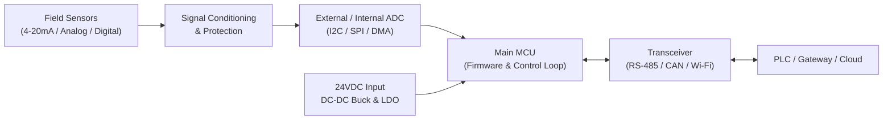

# [Project Title — e.g., Industrial 4–20mA Modbus RTU Sensor Node]

> **One-line Summary:** `[TODO: Concise 1-sentence pitch describing what the system does and its primary technical achievement.]`

---

## 1. Project Overview

- **Role:** `[e.g., Lead Embedded Firmware & Hardware Engineer]`
- **Timeline / Context:** `[e.g., 2026 | Industrial R&D / Personal Project]`
- **Problem Statement:** `[TODO: What engineering challenge or customer requirement initiated this project?]`
- **Solution Summary:** `[TODO: How does your embedded hardware + firmware solve it reliably?]`

<!-- Uncomment once you add an image to ./media/ -->
<!--  -->

---

## 2. System Architecture

---

## 3. Hardware & Board Specifications

| Parameter | Specification |
| :--- | :--- |
| **Board Type** | `[e.g., Custom 2-Layer / 4-Layer FR4 PCB (85mm × 55mm) OR DevKit + Custom Carrier]` |
| **Main MCU / SoC** | `[e.g., STM32G030F6P6 (ARM Cortex-M0+, 64 MHz, 32 KB Flash, 8 KB SRAM)]` |
| **Power Supply** | `[e.g., 9–36 VDC input, reverse-polarity & TVS surge protection, 3.3V Buck/LDO]` |
| **Sensors / Analog Front-End** | `[e.g., TI ADS1115 16-bit ADC, precision 0.1% shunt resistor, RC anti-aliasing filter]` |
| **Communication Interfaces** | `[e.g., Isolated RS-485 (MAX485 / ISO3082), SWD debug header, UART console]` |
| **Actuators / Outputs** | `[e.g., 2x Opto-isolated MOSFET outputs, status LEDs]` |
| **EDA Software** | `[e.g., Altium Designer 24 — Schematic capture, PCB layout, 3D mechanical check, BOM]` |

### Key Hardware Design Decisions
- **Signal Integrity & Noise Immunity:** `[TODO: e.g., Separated analog and digital ground planes with single-point star connection; TVS diodes on RS-485 A/B lines.]`
- **Power Efficiency / Thermal:** `[TODO: e.g., Buck converter selected over linear regulator to handle 24V input without thermal dissipation issues.]`

---

## 4. Firmware & Software Stack

| Layer | Tools & Technologies |
| :--- | :--- |
| **Programming Language** | `C` (C11) / `C++` |
| **IDE & Toolchain** | `[e.g., STM32CubeIDE / Keil MDK-ARM / VS Code + ESP-IDF, arm-none-eabi-gcc]` |
| **OS / Execution Model** | `[e.g., Bare-metal cooperative scheduler + DMA ISRs OR FreeRTOS v10.x]` |
| **SDK / Drivers** | `[e.g., STM32 HAL/LL, Custom I2C ADS1115 driver, Custom Modbus RTU slave stack]` |
| **Debugging & Validation** | `[e.g., ST-Link V2, Saleae Logic Analyzer, Modbus Poll, Oscilloscope]` |
| **Companion Software** | `[e.g., Python PySerial CLI tool for calibration & automated stress testing]` |

### Firmware Architecture & Modules
- **`app_main / task_manager`:** `[TODO: Main state machine / RTOS tasks, priorities, stack allocation]`
- **`drv_sensor`:** `[TODO: Non-blocking I2C/SPI driver, digital filtering (moving average / Kalman), calibration lookup]`
- **`comm_protocol`:** `[TODO: UART IDLE-line DMA reception, CRC16 validation, register map]`
- **`sys_safety`:** `[TODO: Independent Watchdog (IWDG), brown-out detection, sensor open-loop/short fault detection]`

---

## 5. Key Challenges & Engineering Solutions

1. **Challenge:** `[TODO: Describe a real bug or hardware/firmware constraint encountered — e.g., ADC reading drift or RS-485 frame collisions.]`
   - **Root Cause:** `[TODO: What did oscilloscope / logic analyzer measurements reveal?]`
   - **Solution:** `[TODO: How did you fix it in hardware or firmware, and what was the measurable improvement?]`

2. **Challenge:** `[TODO: Tight flash/RAM footprint or real-time latency requirement.]`
   - **Solution:** `[TODO: e.g., Migrated time-critical peripheral code from HAL to LL + DMA, reducing CPU load by X%.]`

---

## 6. Testing, Metrics & Results

| Metric | Target | Measured Result |
| :--- | :--- | :--- |
| **Measurement Accuracy** | `< ±0.2% FS` | `[TODO: e.g., ±0.08% FS calibrated]` |
| **Sampling / Response Rate** | `100 Hz` | `[TODO: e.g., 128 SPS continuous]` |
| **Power Consumption** | `< 50 mA @ 24V` | `[TODO: e.g., 18 mA @ 24V]` |
| **Memory Footprint** | `< 32 KB Flash` | `[TODO: e.g., 21.4 KB Flash / 4.2 KB RAM]` |
| **Continuous Burn-in Test** | `72 hours` | `[TODO: e.g., 7 days zero packet loss / zero resets]` |

---

## 7. Media & Artifacts

- **Hardware (`./hardware/`):** `[TODO: Schematic PDF excerpt, PCB 2D/3D renders, Block Diagram]`
- **Firmware (`./firmware/`):** `[TODO: Public driver modules, header interfaces, or full source link]`
- **Media (`./media/`):** `[TODO: Photos of assembled PCB, oscilloscope/logic analyzer captures, demo GIF]`

---

## 8. Related Links

- **Source Code Repo (if separate):** `[Link or "Proprietary — code snippets available in ./firmware"]`
- **Datasheets / References:** `[Links to key IC datasheets or standards]`
- [← Back to Main Portfolio](../../README.md)
